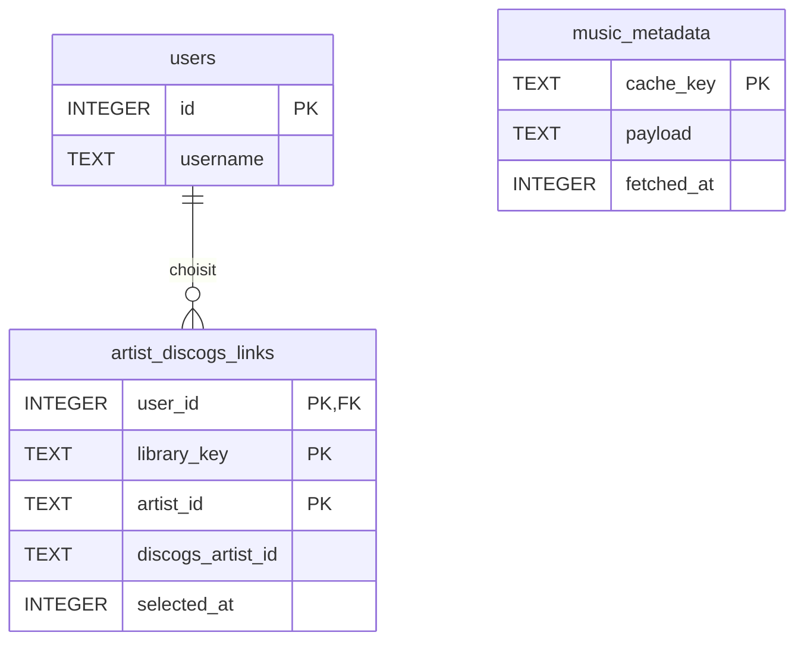
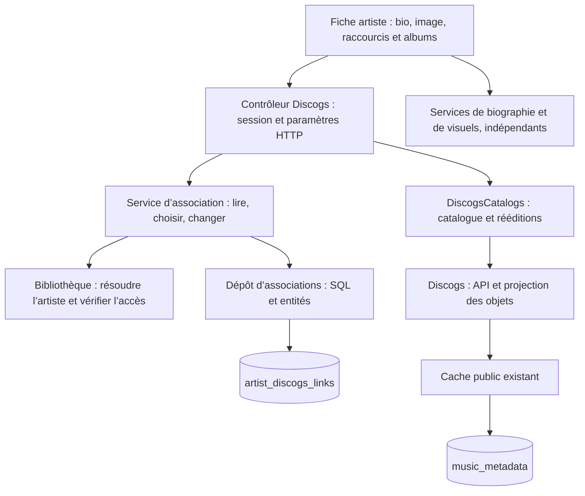

# Découverte des labels et discographies Discogs (web, 1.7.10)

## Arrêt du classement et correspondances YouTube, 1.8.2

Déployée et vérifiée le 08/11/2026.

- « Arrêter l’analyse ici » reprend immédiatement le dernier classement reçu, même si le lot suivant attend une
  réponse. Il ne dépend plus de la fin de cette requête pour préparer une playlist. Une nouvelle génération du
  panneau écarte les réponses tardives ; aucun lot supplémentaire n’est demandé. La requête déjà partie peut
  terminer côté serveur. Avant le premier résultat, l’arrêt est annoncé et le premier lot est utilisé à son arrivée.
  Le bouton concerne l’analyse des notes/compteurs et apparaît après le chargement du catalogue ; il ne prétend
  plus interrompre ce chargement préalable. Le classement conserve source, critère et périmètre provisoire.
- Sélection visible et focalisée à l’arrêt, alimentée album par album. Écoute et enregistrement accessibles en haut
  dès qu’un titre est choisi, sans attendre toutes les recherches Subsonic ou YouTube. Les ajouts préservent les
  choix et ne modifient pas la file déjà lancée. Les recherches YouTube restent limitées à deux demandes automatiques
  en parallèle et réutilisent une seule vérification de source pour l’aperçu. La préparation affiche son avancement.
- La sauvegarde capture les choix au moment d’envoyer la demande ; les pistes ajoutées ensuite ne gonflent ni la
  playlist enregistrée ni le compteur du message. Un enregistrement en cours reste protégé contre un second clic,
  même lorsque de nouvelles pistes arrivent. Poursuivre reprend au dernier offset confirmé. Si aucun disque n’a de
  données de classement, une explication invite à poursuivre ou à utiliser la découverte ; aucune playlist vide créée.
- Les lectures déjà en cache des fournisseurs n’attendent plus leur verrou réseau occupé par un autre disque.
  Les lectures manquantes restent dédupliquées sous ce verrou ; TTL et rythme des appels conservés.
- Parser YouTube : seuls les suffixes correspondant à un label de l’édition sont retirés de la comparaison, ainsi
  que les codes catalogue identifiables entre crochets. Les mentions musicales de parties, remixes et versions sont
  conservées. Une ressemblance de 0,93 est acceptée pour un titre long si sa durée est connue et très proche
  (2 %, plancher 5 s, plafond 15 s) ; sinon seuil 0,94. Titres courts et chiffres toujours exacts, artiste et version
  toujours vérifiés. Textes affichés et données source inchangés ; aucun fournisseur payant ni requête supplémentaire.
- Cas réel : Discogs « Endless Pavments », vidéos « Endless Pavements » / « Endless Pavement », label Macadam Mambo
  et code MMLP1001 ajoutés aux titres. La vidéo liée par Discogs correspond et passe après correction. La vidéo
  communiquée par l’utilisateur est intitulée « Hooked Up » : elle n’est pas choisie pour l’autre titre malgré sa durée
  proche. Les cinq pistes du disque ont une correspondance liée et leur seconde demande réutilise le cache dans Docker.
- Code : `label-discovery.js`, `discovery-tracks.js`, `youtube_matching.py`, `youtube_versions.py`, `music_metadata.py`.
  Contrôleurs, tables et migrations inchangés. Tests : `e2e_label_pause_checks.js` (lot bloqué, progression, écoute,
  sauvegarde partielle réelle, réponses tardives, reprise, arrêt avant le premier lot, absence de disque classable),
  `test_youtube_versions.py` (décorations, orthographe, titres/versions différents), `test_label_discovery.py` (cache
  accessible malgré un appel bloqué). **613 tests Python et cinq parcours jsdom passent** dans l’image finale ;
  parcours PC aussi passé isolément. Le test attend effectivement le nouveau rendu de la barre des artistes avant
  d’émettre son second rechargement et nettoie sa playlist temporaire, sans retirer d’assertions existantes.
  Chrome clair/sombre à 1 440, 390 et 320 px : sélection utilisable avec le classement et l’album suivant bloqués,
  focus, compteurs et actions visibles ; réponse tardive ignorée et écoute lancée conservée. Cinq pistes et cache
  de Hooked Up vérifiés avec les API réelles depuis l’image reconstruite. Audio réel non vérifié. Sauvegarde préalable :
  `../pimedia-backups/pre-1.8.2-20261108T190313Z/`, base intègre au schéma 16. Publication vérifiée : 202 fichiers
  applicatifs identiques, HTTPS sain, version 1.8.2, ressources/textes conformes et routes protégées. Les cinq pistes
  réelles de Hooked Up et leur cache sont aussi vérifiés depuis le conteneur déployé, dans une base temporaire.

## Versions YouTube précises, 1.8.1

Déployée et vérifiée le 08/11/2026.

- Les pistes sans correspondance sûre dans la bibliothèque sont recherchées automatiquement après le rapprochement
  local. Deux demandes au maximum en parallèle ; une nouvelle sélection ou navigation abandonne les réponses et
  la file précédentes. Une piste locale choisie pendant l’attente est conservée, comme le choix d’ignorer un titre.
- L’édition Discogs fournit les pistes et ses liens YouTube publics. Les liens au titre/durée compatibles sont
  vérifiés chez YouTube d’abord : métadonnées actuelles, intégration et région. Un album entier ou un extrait n’est
  pas attribué à une piste. Si un lien convient, aucune recherche textuelle n’est lancée ; sinon une seule requête
  artiste/titre/version, puis filtrage local des résultats. Trois vidéos distinctes au maximum, parfois zéro.
- Artiste crédité dans le titre ou dans les métadonnées, titre très proche (exact pour les titres courts et nombres),
  version demandée et durée (écart maximal de 15 secondes ou 12 %) contrôlés. Un lien Discogs peut confirmer l’artiste
  d’une vidéo nommant seulement le morceau ; son titre et sa durée doivent toujours correspondre. Les remixes
  explicitement demandés sont conservés ; le filtre général « studio » des autres recherches reste inchangé.
- Progression globale et par titre, attente animée respectant la préférence de mouvement réduit, erreurs et réessai
  visibles. Résultats sous forme de petites cartes avec titre réel, durée et provenance Discogs éventuelle.
  La personne choisit la version ; aucune lecture ni sélection YouTube automatique. Écoute et enregistrement passent
  toujours par le lecteur et les playlists mixtes existants.
- `YouTubeVersions` orchestre la recherche ; `youtube_matching.py` contient les petites fonctions pures de pertinence.
  `Discogs` projette les liens dans `DiscogsVideo`, sans description brute ; projection des éditions versionnée pour
  relire les anciens caches sans liens. `LabelDiscovery` vérifie que la piste appartient à l’édition et utilise ses
  métadonnées canoniques. POST `/api/labels/versions` authentifié/CSRF, contrôleur limité aux paramètres et sérialisation.
- `ExternalMusic` / `YouTubeSource` gardent les appels et budgets existants. Cache des recherches et `youtube_videos`
  communs aux favoris et playlists ; résolution des liens centralisée, parseur `external_links.py` commun aux favoris
  et Discogs. Les liens directs utilisent `videos.list` par lots de 50 (une unité), sans `search.list`. Filtrage local,
  aucun fournisseur payant ou IA ajouté ; les recherches non cachées et vérifications de liens inconnus restent limitées.
  Aucun nouveau schéma SQL, secret côté serveur. Les choix de vidéos ne sont pas encore mémorisés durablement par titre.
- Tests : `test_youtube_versions.py`, sources Discogs et favoris existants, parcours PC et réponses différées dans
  `e2e_discovery_checks.js`. Sonde réseau facultative `check_youtube_versions.py --release ID`, configuration du conteneur,
  base temporaire ; aucun compte de bibliothèque. **608 tests Python et cinq parcours jsdom passent** ; parcours PC
  repassé après les finitions dans l’image finale. Chrome clair/sombre, 1 440/390/320 px : progression compacte,
  versions et sélection visibles, cartes sans débordement. API réelle : édition Muslim Disco Club fournie,
  correspondances vérifiées pour Djetelina, Sladjana et Kurosava ; zéro pour Osjecam, sans résultat arbitraire.
  Seconde demande sans nouvel appel YouTube. Écoute audio réelle non vérifiée. Sauvegarde préalable au schéma 16 :
  `../pimedia-backups/pre-1.8.1-20261108T183148Z/`. Publication : 202 fichiers applicatifs identiques aux sources testées,
  HTTPS sain, version 1.8.1, ressources/textes conformes, nouvelle route POST protégée, SQLite intègre au schéma 16.
  Les quatre pistes et leur cache sont aussi vérifiés depuis le conteneur déployé, dans une base temporaire.

## Fiches artiste et album, 1.8

Réalisées, déployées et vérifiées le 08/11/2026 à partir de la maquette « Raccourcis » validée.

- Bio directement sous le nom de l’artiste, repliable et sourcée. Visuel chargé par une route indépendante : la
  photo peut apparaître sans texte et la bio reste visible sans image. Aucun cadre vide si une image échoue.
- Boutons compacts et raccourcis visibles en haut : albums, discographie et membres pour l’artiste ; pistes,
  crédits Discogs et labels pour l’album. Les raccourcis gardent la fiche et placent le focus sur la section.
- Albums locaux avant la discographie Discogs, puis membres/groupes et complément MusicBrainz. Les crédits et
  labels restent sous les pistes de l’album. Lecture, radios, mix et autres sections existantes conservés.
- Choix explicite d’une identité Discogs dans le dialogue existant ; association enregistrée avant le chargement
  du catalogue. Prochaines visites : discographie et relations chargées automatiquement, sans nouveau sélecteur.
  Nom et identifiant de la fiche associée affichés. « Changer » conserve l’ancien choix jusqu’au nouveau choix réussi.
- « Actualiser » recharge la première page du catalogue choisi et invalide ses autres pages après succès, pour
  reprendre une pagination cohérente. Autres artistes/labels et Last.fm conservés. Un échec laisse la sélection et
  le catalogue affiché utilisables ; le bouton de réessai garde l’intention d’actualiser.
- Migration 16 : `artist_discogs_links`, clé `(user_id, library_key, artist_id)`, identifiant Discogs et date du choix.
  Bibliothèque identifiée par l’empreinte de son URL configurée, dossier canonique après résolution ID3. Le service
  relit l’accès local et vérifie l’index autorisé du compte. Suppression en cascade avec le compte, pas de TTL.
- Visuels : image de la fiche Discogs confirmée, puis URLs HTTPS connues de Subsonic. Wikipédia est utilisé sans
  association, ou depuis un lien Wikipédia explicite de la fiche choisie ; aucun autre homonyme Wikipédia choisi
  par nom quand une association existe. Visuels vides Last.fm, URL avec identifiants ou paramètres et hôtes inconnus
  écartés. Cache de visuels d’une heure en mémoire par compte/artiste/association ; projection publique Discogs
  versionnée et cache 24 h distincts. Le jeton Discogs reste strictement serveur.
- Code : `artist_discogs.py`, `artist_portraits.py`, `artist_entities.py`, `storage/artist_links.py` ; contrôleurs
  Discogs et Facts, assemblage dans `app.py`. Cache et rééditions restent dans leurs services. Interface :
  `artist-profile.js`, `artist-discography.js`, `page-sections.js`, intégration `views.js`, styles `artist-pages.css`.
  Symbole Discogs issu de Simple Icons 15.20.0 embarqué dans les icônes existantes, sans CDN à l’exécution.
- Routes nouvelles : GET/POST `/api/discogs/artist-link`, POST `/api/discogs/artist-refresh`, GET `/api/artist/image`.
  Session obligatoire, écritures CSRF. L’association ne détermine jamais l’édition d’un album.
- Couverture : `test_artist_discogs.py` (16 tests : migration, survie au cache/reconnexion de base, homonymes,
  dossiers/ID3, comptes/bibliothèques, accès retiré, CSRF, échecs, actualisation ciblée, bio et images indépendantes),
  parcours PC jsdom adapté et enrichi. Les 54 tests ciblés et le parcours PC passent sur les sources actuelles dans Docker.
- Validation complète du lot sous son numéro provisoire 1.7.15 : **593 tests Python et les cinq parcours jsdom passent**. L’attente initiale
  du parcours PC attend désormais la fin du chargement des ressources et l’écran de connexion, au lieu d’enchaîner
  après un délai de trois secondes dépassé ; les vérifications de textes et de connexion sont conservées.
  Chrome : choix retrouvé après rechargement, actualisation, ancres/focus, fiches artiste/album en clair/sombre à
  1 440, 390 et 320 px ; nouveaux blocs sans débordement et aucune erreur JavaScript. Les limitations mobiles
  préexistantes de la barre du haut, du lecteur et des tableaux restent hors de cette évolution.
- API réelle dans l’image web : identité exacte de Vitalic, image disponible, 95 disques regroupés dans la première
  page d’un catalogue de six pages ; actualisation ciblée, choix conservé après expiration du cache et réouverture
  de la base. Base temporaire au schéma 16, aucun compte de bibliothèque ni playlist de production utilisé.
- Décision finale utilisateur du 08/11/2026 : **1.8** pour le lot Discogs et **1.7.13** pour la retouche des compteurs,
  après 1.7.12. Les numéros provisoires 1.7.14/1.7.15 ne restent pas dans l’historique public. Sauvegarde avant migration :
  `../pimedia-backups/pre-1.7.15-20261108T165103Z/`, code/configuration/base cohérente et image de retour arrière.
- Renumérotation : les cinq tests d’historique et le parcours PC complet passent sur l’image 1.8 reconstruite.
  Sauvegarde cohérente complémentaire au schéma 16 avant cette publication :
  `../pimedia-backups/pre-1.8-20261108T170300Z/`. Le code fonctionnel reste celui du lot validé intégralement.
- Contrôle du raccourci pendant le chargement initial de l’association : attendre le choix enregistré avant de
  décider d’ouvrir le sélecteur. « Changer » reste l’action explicite pour le rouvrir ; scénario jsdom ajouté et validé.
- **1.8 en production vérifiée** : 198 fichiers applicatifs identiques aux sources testées, HTTPS sain, version et
  historique public complet conformes (1.8 → 1.7.13 → 1.7.12), ressources et routes protégées contrôlées ; SQLite
  intègre au schéma 16. La sonde Discogs réelle repasse depuis le conteneur déployé, avec sa base temporaire.
  La validation du son et un parcours connecté avec la bibliothèque réelle ne sont pas inclus dans ce contrôle.

La navigation globale par labels reste le [brouillon pour plus tard](navigation-labels.md).

## Correctif 1.7.11 : distinguer une société du label musical
- Cas réel signalé : Sub Pop Records est une fiche de société dans Discogs, qui renvoie explicitement vers le label
  Sub Pop. Son catalogue contient les licences et droits de disques publiés ailleurs. Le contrôle d’édition rejetait
  donc les quinze premiers disques analysés, puis l’interface présentait « 0 titres choisis sur 0 proposés ».
- Les indications explicites « use only as a company » de Discogs sont désormais prises en compte. Après choix
  d’une société, la page explique la distinction et propose les fiches de labels liées par Discogs, en privilégiant
  celles citées dans cette indication. Le choix reste explicite ; aucun rapprochement arbitraire par nom, aucun
  identifiant de label spécifique dans le code et aucun assouplissement des contrôles d’édition.
- Le serveur refuse cette fiche de société avant de parcourir son catalogue : HTTP 400 `discovery.company_only`.
  Le contrôleur reste un adaptateur ; la projection des indications est dans `Discogs`, la règle de catalogue
  dans `DiscogsCatalogs`, les données dans `DiscogsLabel`.
- La nouvelle projection d’identité utilise une clé de cache versionnée. Les anciennes entrées ne contenant que
  le nom ne masquent donc pas l’avertissement pendant 24 h. Profil brut et contacts restent exclus du cache ; seuls
  le marqueur d’usage et les identités liées nécessaires à la navigation sont conservés.
- Une sélection vide affiche une explication, sans compteur « 0 sur 0 » ni boutons d’écoute/enregistrement.
  L’aperçu précédent est effacé au lancement d’une nouvelle analyse ; la file du lecteur est conservée.
- Régression : cas société avec label et éditeur liés, référence par nom/identifiant, reprise du cache 1.7.10,
  refus avant lecture du catalogue et parcours société → label → sélection. Tests dans `test_label_discovery.py`
  et `e2e_webapp.js`.
- Vérification du cas réel dans Docker : Sub Pop Records reconnu comme société, lien vers Sub Pop confirmé ;
  trois éditions du label donnent 36 pistes renseignées. Catalogue réel de Sub Pop chargé en cache (111 pages,
  11 098 entrées) ; sélection de quinze disques donnant 28 pistes proposées, sans compte Subsonic ni playlist créée.
- Validation : 567 tests Python et cinq parcours jsdom validés ; PC rejoué isolément après trois échecs initiaux
  de connexion. Passage société → label et affichage des pistes contrôlés dans Chrome.
- **1.7.11 déployée et vérifiée le 08/11/2026** : HTTPS, version, ressources publiques et 187 fichiers applicatifs
  identiques aux sources testées ; base intègre au schéma 15. Société et lien de label relus depuis la production,
  sélection réelle de quinze disques et 28 pistes confirmée. Sauvegarde préalable dans
  `../pimedia-backups/pre-1.7.11-20261108T015242Z/` depuis le projet distant. Recharger la page pour le nouvel écran.

## Parcours
- Depuis un label MusicBrainz : rechercher la fiche Discogs et **choisir explicitement l’identité**, sans attribuer
  automatiquement un homonyme. Depuis le label d’une édition Discogs choisie, l’identité est déjà connue.
- **Découvrir le label** : catalogue paginé, rééditions regroupées, puis jusqu’à 15 disques au hasard. Le tirage
  privilégie les artistes et décennies encore peu représentés, sans score de popularité : les sorties sans vote et
  peu connues restent éligibles. Deux pistes au plus par disque, choisies au hasard.
- **Top du label** : choix de la source et du critère, explication et chiffres affichés. Analyse par lots de cinq
  disques, compteur, arrêt et poursuite possibles. Le classement partiel est explicitement provisoire ; les quinze
  premiers disques alimentent la sélection. Les albums sans donnée positive ne sont pas classés.
- Les pistes passent **d’abord par la bibliothèque du compte courant**, avec le rapprochement des imports. Les
  correspondances sûres sont présélectionnées ; les autres restent à vérifier ou ignorées. Recherche automatique
  des versions YouTube pour les autres pistes, puis **choix explicite de la vidéo**, sans premier résultat automatique.
- **Écouter** reprend le lecteur et sa file mixtes. **Enregistrer** réutilise `/api/import/create` et
  `Playlists.create_mixed` : ordre conservé, ignorés exclus, doublons d’identifiant retirés. Droits `stream`/`playlist`
  appliqués, création protégée par CSRF. Une panne d’une source ne remplace jamais la lecture courante.

## Rééditions et critères
- Un disque par master Discogs. Sans master : artiste et titre exacts normalisés, sans fusionner deux masters
  distincts. Les rééditions de pages différentes sont réunies. Sans identifiant fiable, le texte ne garantit pas
  que deux éditions correspondent au même disque.
- Édition représentative : la plus ancienne datée **chez ce label**, sinon ordre stable par identifiant. Ses pistes,
  sa date et sa note sont utilisées. Ce n’est pas une date originale universelle, notamment pour un label de rééditions.
- Le catalogue Discogs peut aussi contenir des associations de sociétés (droits, fabrication…). Le service vérifie
  les crédits de label de l’édition et essaie les suivantes, au plus dix par disque. Sans confirmation, le disque est
  écarté et compté explicitement, sans bloquer le classement ni lui attribuer une popularité Last.fm. Les cartes de
  découverte sont actualisées après cette vérification ; la sélection finale peut compter moins de quinze disques.
- **Discogs** : note de cette édition décroissante, puis votes décroissants. Note, votes et lien de l’édition affichés.
  Les votes des rééditions ne sont pas additionnés, et aucune « moyenne du master » n’est inventée. Les éditions sans
  vote sont exclues du Top. Une forte note avec peu de votes reste possible et visible comme telle.
- **Last.fm** : auditeurs ou écoutes de l’album, toutes périodes confondues ; les deux compteurs sont affichés.
  `album.getInfo` est croisé avec le catalogue Discogs identifié : pas de méthode Last.fm « top label ». Les réponses
  d’un autre artiste/titre sont écartées. Les noms des albums et les compteurs viennent de la source, pas de Subsonic.

## Discographies, crédits et musiciens
- Page artiste : **Voir la discographie Discogs**, recherche et choix de fiche, pochettes, années et formats,
  disques principaux séparés des participations, pagination et rééditions regroupées. Les albums trouvés chez la
  personne ont un lien local ; les autres proposent une recherche. Aucun état de disponibilité n’est partagé entre
  comptes. Les résultats bornés de `search3` ne prouvent pas qu’un fichier absent des résultats n’existe pas.
- Page album : **Voir les crédits Discogs**, avant le complément MusicBrainz. Recherche par artiste et titre de
  l’album accessible, édition choisie explicitement même unique ; édition d’un autre album refusée côté serveur.
  Labels, artistes principaux, crédits d’édition et de pistes sont cliquables.
- Fiches intégrées `#/discogs/artist/…` et `#/discogs/label/…` : album → musicien → groupes → discographie,
  et album → label → découverte. Les membres/groupes viennent de la fiche Discogs, **sans chronologie garantie** ;
  ce ne sont pas les crédits d’un album précis. MusicBrainz reste un complément séparé et sourcé.
- La couverture dépend des contributions à chaque base : aucune exhaustivité garantie. Pochettes, éditions et
  classements gardent leurs attributions et liens de source.

## Architecture, configuration et conservation
- Fournisseurs distincts : `webapp/discogs.py` et objets `discogs_entities.py` ; `webapp/lastfm.py` et objet de
  popularité. Aucun appel à l’un dans l’autre. Transport/cache commun dans `music_metadata.py`.
- SQL exclusivement dans `storage/exploration.py`, entité `CachedMetadata`, table existante `music_metadata`.
  Schéma 15 inchangé. Projection limitée aux champs utiles : aucun profil, contact, collection ou marché.
- Services : `discogs_catalogs.py` (pagination/regroupement), `discogs_exploration.py` (crédits de l’album accessible),
  `label_discovery.py` (variété, classement, pistes et priorité locale). Objets dans `catalog_entities.py` et
  `label_entities.py`. Petits adaptateurs HTTP dans `controllers/discogs.py`, assemblage dans `app.py` seulement.
- Routes authentifiées : `/api/discogs/status`, `/search`, `/identity`, `/catalog`, `/album` ;
  `/api/labels/discover`, `/ranking`, `/tracks`. Types, identifiants numériques, pages, offsets et appartenance au
  catalogue/album sont validés avant les lectures associées. Aucune URL fournie par le navigateur n’est téléchargée.
- `.env` : `DISCOGS_API_KEY` → variable du conteneur `PI_MEDIA_WEB_DISCOGS_API_KEY` → `WebConfig.discogs_api_key`.
  Jeton en en-tête, **jamais dans une URL, un cache, une réponse ou un diagnostic**. `LASTFM_API_KEY` sert aussi aux
  statistiques d’albums ; sa clé est exclue des clés de cache. Les secrets restent sur le serveur.
- Métadonnées publiques conservées 24 h ; entrées anciennes du fournisseur supprimées à la lecture. Pas de cache
  des recherches Subsonic entre comptes. Au moins 1,1 s entre appels Discogs et 0,25 s pour Last.fm, déduplication
  par fournisseur, `Retry-After` des 429 respecté, reprise au clic. Plusieurs processus doivent coordonner leur quota.
- Maximum technique : 100 entrées par page, 1 000 pages ; dépassement signalé. Les recherches d’identités/éditions
  examinent au plus 100 résultats. La recherche YouTube conserve les budgets du site et contrôle la version demandée.
- Interface : `discogs.js`, `discogs-credits.js`, `label-discovery.js`, `discovery-tracks.js`, `discovery-versions.js` ; intégration dans les
  vues existantes, cartes/icônes/thèmes/lecteur/dialogues réutilisés. Textes `webapp.discovery`, styles adaptatifs.

## Vérifications et limites
- `tests/test_label_discovery.py`, `fake_discogs.py` : sources, cache, secrets, rééditions sur plusieurs pages,
  variété, raretés, note d’édition, critères Last.fm, lots bornés, sessions, choix d’édition, crédits, relations,
  priorité locale et absence de partage des résultats privés.
- `tests/e2e_webapp.js` : deux modes, homonymes, méthode/chiffres, versions YouTube, écoute et sauvegarde mixtes,
  discographie, album → musicien → groupes et label Discogs direct.
- Validation finale Docker : **562 tests Python et cinq parcours jsdom passent** sur l’image reconstruite.
  Contrôle Chrome clair/sombre ; nouveaux blocs sans débordement à 390 px. La barre supérieure et le lecteur PC
  préexistants restent peu adaptés à cette largeur.
- Sonde facultative `tests/check_discovery_sources.py` : configuration de l’image web, base temporaire, aucun compte
  Subsonic. Noms en arguments, sorties limitées aux compteurs :
  ```bash
  docker compose -f compose.yaml run --rm --no-deps -T web python3 - --label "$LABEL_NAME" --artist "$ARTIST_NAME" < tests/check_discovery_sources.py
  ```
- Sources réelles vérifiées depuis Docker le 08/11/2026 : catalogue Clivage Music (19 disques regroupés), notes et
  votes, sélection de quinze disques et Top sur les 19 disques analysés, associations de sociétés écartées ;
  statistiques Last.fm et discographie de Vitalic (95 disques
  regroupés dans la première page). Jetons et identité du compte Discogs non affichés.
- Comparaison ciblée : sept membres de Kyuss dans chaque base ; douze groupes de Josh Homme chez Discogs, neuf chez
  MusicBrainz, avec des liens propres à chacune. Pour l’édition comparée de « Dissidænce Episode 2 » : sept crédits
  Discogs, aucune relation de crédit MusicBrainz. Cela ne prouve pas une supériorité générale d’une base.
- **Déployé le 08/11/2026** : conteneur et HTTPS sains, version publique 1.7.10, routes protégées, ressources servies
  identiques aux fichiers testés et 187 fichiers applicatifs du conteneur vérifiés. SQLite intègre, schéma 15 inchangé.
  Clé Discogs ajoutée au serveur sans affichage ; API réelles vérifiées depuis la production (catalogue, note/votes,
  premier lot du Top, compteurs Last.fm, discographie et recherche d’éditions/crédits).
  Sauvegarde préalable code/configuration/base/image dans `../pimedia-backups/pre-1.7.10-20261107T233314Z/`
  depuis le projet distant. Lecture audio YouTube réelle et parcours connecté à la bibliothèque de production
  encore à vérifier ; interactions testées avec les sources simulées.

Sources : [API Discogs](https://www.discogs.com/developers/),
[conditions API](https://support.discogs.com/hc/en-us/articles/360009334593-API-Terms-of-Use),
[album.getInfo Last.fm](https://www.last.fm/api/show/album.getInfo).

## Conception du 08/11/2026 : choix mémorisé et accès visibles

**Conception historique, validée puis réalisée en 1.8 ci-dessus.** La navigation globale par labels reste un
[brouillon séparé pour plus tard](navigation-labels.md).

### Constats avant la 1.8

- Les réponses Discogs sont en cache SQLite pendant 24 h. Cela évite de refaire chaque appel externe, mais le choix
  d’un artiste homonyme n’est conservé que dans le composant de la page. Une nouvelle visite redemande la sélection.
- `DiscogsUI.artistPanel` ne reçoit actuellement que le nom de l’artiste, sans son identifiant local.
- Dans `views.js`, le bloc Discogs puis le bloc MusicBrainz précèdent la biographie, les titres populaires et les
  albums. L’ouverture de la discographie repousse donc ces contenus vers le bas.

### Comportement proposé

- Premier passage : choix explicite de la bonne fiche Discogs. Enregistrer l’association avec l’identifiant de
  l’artiste de la bibliothèque, son fournisseur et l’identité externe. Le nom seul ne suffit pas pour les homonymes.
- Aux visites suivantes : retrouver cette association côté serveur et afficher automatiquement la discographie
  en dessous des albums locaux ; le sélecteur reste fermé. Le choix survit à la déconnexion, au redémarrage et au
  changement d’appareil, indépendamment de l’expiration des réponses publiques.
- « Changer » rouvre le choix d’identité ; l’association en place reste valable tant qu’un autre choix n’a pas
  été confirmé. « Actualiser » recharge le catalogue de cette identité sans redemander quelle fiche utiliser.
- Pour une première réalisation, proposition d’association propre au compte et à l’artiste local. Vérifier l’accès
  à cet artiste avant lecture/écriture. Un éventuel partage éditorial entre comptes reste une décision distincte.
- Sur l’album, garder la même hiérarchie : accès visible en haut, crédits et labels sous les pistes. Une édition
  d’album est une autre association ; ne pas déduire son choix du seul choix de l’artiste.

### Présentation à comparer dans la maquette

- **Raccourcis / ancres** (proposition privilégiée) : accès « Albums », « Discographie Discogs », « Membres et groupes »
  en haut de l’artiste ; « Pistes », « Crédits Discogs », « Labels » en haut de l’album. Les contenus restent sur la
  même page, avec la bibliothèque d’abord. Accès nommés et utilisables au clavier ; le chargement distant ne
  remplace pas le contenu local.
- **Onglets** : même visibilité en haut, mais une seule section affichée à la fois. Alternative à essayer, car elle
  réduit la longueur de page en masquant une partie du contenu.
- Identité Discogs associée visible, actions « Changer » et « Actualiser » discrètes, cartes et icônes cohérentes
  avec l’application. Ne pas afficher un grand formulaire de recherche à chaque visite.
- Affinements demandés dans la maquette : biographie directement sous le nom, extrait puis « Lire la suite »,
  emplacement de photo à côté, boutons d’action plus compacts et symbole Discogs reconnaissable. La variante
  « Raccourcis » est celle sélectionnée dans la comparaison ; l’alternative par onglets reste consultable.

### Structure envisagée

- Un dépôt d’associations avec SQL et entités typées, séparé du cache public à durée limitée.
- Un petit service d’association/résolution : accès à l’artiste local, récupération, validation et remplacement
  du choix. Le fournisseur `Discogs` garde les appels et projections de sa source ; `DiscogsCatalogs` garde les
  règles de catalogue. Le contrôleur adapte seulement la session et les paramètres HTTP, écritures avec CSRF.
- Le composant d’interface reçoit l’identifiant local, charge l’association, puis le catalogue connu. Chargement
  progressif/pagination conservés ; aucun catalogue partiel présenté comme complet.
- La maquette simule ces interactions avec des données illustratives. Aucun choix réellement enregistré dans
  l’application, aucune migration et aucun déploiement à ce stade.
- Maquette comparative « Raccourcis » / « Onglets », fiches artiste et album : contrôlée dans Chrome en clair/sombre,
  aux largeurs 1 080, 736, 390 et 320 px. Sélection d’un homonyme, maintien du choix lors d’une actualisation,
  changement de fiche et navigation clavier des onglets simulés ; aucune erreur JavaScript relevée.

### Biographie et images : constat et proposition

- `facts.py` choisit une biographie Wikipédia française, sinon Last.fm via Subsonic, sinon Wikipédia anglaise.
  L’image renvoyée reste une vignette Wikipédia, y compris dans le parcours Last.fm. Les adresses d’image présentes
  dans `getArtistInfo2` ne sont pas reprises. Une biographie française sans vignette ne cherche pas une image dans
  les autres sources ; `views.js` n’affiche rien lorsque le texte est vide, même si une image pouvait être disponible.
- Séparer une entité de biographie et une entité de visuel, chacune avec sa source, son lien et sa date de lecture.
  Le chargement ou l’absence de l’une ne doit pas masquer l’autre.
- Proposition d’ordre pour les visuels : fiche Discogs explicitement associée, URLs Subsonic liées à l’artiste ID3,
  puis Wikipédia si l’identité correspond de façon fiable. Une image Discogs peut aussi être un logo d’artiste ;
  ne pas promettre une photo disponible pour chaque groupe, ni choisir le premier homonyme trouvé par nom.
- Un service de visuels choisit les candidats ; les fournisseurs récupèrent et projettent les seuls champs utiles.
  Un échec d’image laisse le nom, la bio, les albums et les raccourcis utilisables.
- Dans la maquette, le cadre photo est un emplacement explicite, sans image attribuée arbitrairement à Ripper.
  Le texte de présentation s’appuie sur les pages publiques du groupe et du label ci-dessous. La bibliothèque,
  les correspondances Discogs et les interactions restent illustratives.

Sources consultées le 08/11/2026 : [API Subsonic](https://www.subsonic.org/pages/api.jsp#getArtistInfo2),
[modèle Artist du client publié par Discogs](https://github.com/discogs/discogs_client/blob/master/discogs_client/models.py),
[images d’artistes Discogs](https://support.discogs.com/hc/en-us/articles/360005006874-Database-Guidelines-13-Images),
[groupe sur Bandcamp](https://ripperdeathrashchile.bandcamp.com/),
[édition 2016 sur Bandcamp](https://ripperdeathrashchile.bandcamp.com/album/experiment-of-existence),
[présentation du label en 2026](https://darkdescentrecords.bandcamp.com/album/towards-rebirth).
Symbole Discogs de la maquette : [Simple Icons, version 15.20.0](https://cdn.jsdelivr.net/npm/simple-icons@15.20.0/icons/discogs.svg) ;
le site final embarquerait son fichier graphique avec ses ressources, sans dépendre du CDN pour ses boutons.

### Modèle de données proposé pour le choix d’artiste

Une seule nouvelle table est nécessaire pour mémoriser l’identité de l’artiste. `users` et `music_metadata`
existent déjà ; les colonnes montrées ici sont limitées à celles utiles à cette conception.



- Clé unique composée `(user_id, library_key, artist_id)` : un choix par compte et artiste de cette bibliothèque.
  `library_key` identifie la bibliothèque configurée, calculée côté serveur sans secret ni valeur personnelle
  codée en dur. Cela évite de réutiliser un choix si l’installation change de serveur Subsonic.
- `artist_id` est l’identifiant canonique de dossier utilisé par les fiches du site. Le service résout les éventuels
  identifiants ID3 vers ce dossier ; ne pas enregistrer deux associations pour les deux accès au même artiste.
  Le serveur vérifie que le compte peut encore accéder à cet artiste. Il n’existe pas de table relationnelle complète
  d’artistes locaux : aucune fausse clé étrangère vers le JSON de `artist_indexes`.
- `discogs_artist_id` est l’identité externe choisie et validée ; `selected_at` date le dernier choix. Aucun nom
  d’homonyme utilisé comme clé et aucune expiration de cette décision. Suppression du compte : suppression en cascade.
- `music_metadata` conserve les réponses publiques projetées, avec leur durée de cache propre. Pas de clé étrangère
  depuis l’association vers une entrée expirante. La disponibilité locale reste calculée avec le compte courant.
- Aucune table de labels ou d’albums créée pour ce changement. Une éventuelle mémorisation de l’édition d’un album
  aurait sa propre relation : l’association de l’artiste ne détermine pas son édition.

### Assemblage applicatif proposé



Le service d’association proposé aurait de petites méthodes `get`, `choose` et `forget`. Le fournisseur Discogs
validerait et chargerait une identité de type artiste ; `DiscogsCatalogs` garderait ses propres responsabilités.
Le dépôt ne ferait que lire/enregistrer/supprimer une entité d’association. Last.fm reste dans son fournisseur séparé.
Les services ne dépendent pas du contrôleur ; les dépendances sont assemblées dans `app.py`.

Parcours de lecture : afficher le contenu local, récupérer l’association, puis charger le catalogue de l’identité
connue. Sans association, ouvrir le sélecteur sur demande ; au choix confirmé, enregistrer avant de charger le
catalogue. Un échec réseau de catalogue conserve l’association pour réessayer la même fiche. « Changer » ne remplace
la relation qu’au choix confirmé ; « Actualiser » contourne le cache des pages concernées sans toucher à cette relation
ni vider les autres fournisseurs. Les contrôleurs d’écriture appliquent session, validation et CSRF.

À vérifier lors de la réalisation : survie du choix aux redémarrages et à l’expiration du cache, homonymes distincts,
accès et isolation entre comptes, résolution dossier/ID3, actualisation ciblée et panne de source, image sans bio et
bio sans image, erreurs de chargement des photos, clavier et affichage mobile. Nouvelle migration à ajouter après
la migration publiée 15 ; aucune migration écrite à ce stade.
